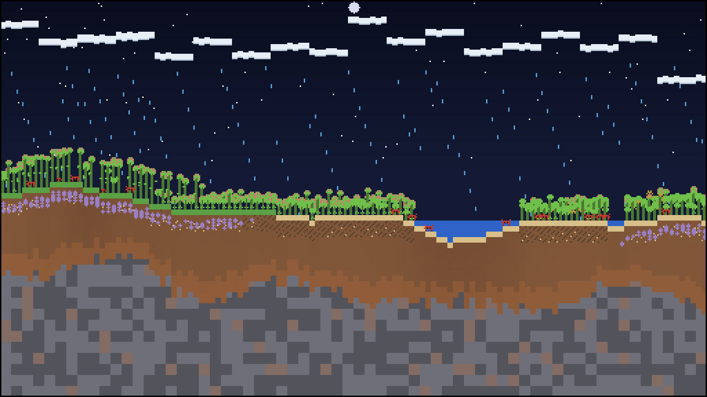

# Terrarium

A digital ecosystem that lives in this repository. Four trophic guilds, three
conserved elements, and a closed set of biogeochemical cycles. A scheduled
GitHub Actions job advances the world, renders it, and commits the result, so
the terrarium keeps growing between visits and its entire history is the commit
log.



**[Open the live viewer](https://buttonoperator.github.io/terrarium/)** for
playback of the last 64 frames, population and nutrient charts, the mass
ledger, the lineage table and the chronicle. It updates whenever the world
ticks. To run the same page locally:

```bash
python -m http.server -d docs 8000
```

## Current state

<!-- STATUS:start -->
| | |
|---|---|
| **Tick** | 7296 (day 304, hour 00 of year 6, high summer) |
| **Temperature** | 19.9 C |
| **Flora** | 533 (5861 C units, tallest 7.6 tiles) |
| **Grazers** | 0 (0 C units) |
| **Predators** | 15 (286 C units) |
| **Decomposers** | 342 (960 C units) |
| **Atmosphere** | CO2 9239, vapour 11485, cloud 8402 |
| **Soil** | 37% saturated, mineral N 1625, litter C 8970 |
| **Lineages** | 4 living of 16 ever, 10 recolonisations |
| **Mass ledger** | C -7.63e-09, N +1.36e-11, H2O +2.17e-09 drift |
| **Updated** | 2026-10-30 18:01 UTC |
<!-- STATUS:end -->

## What is actually simulated

This is not a screensaver. The world is a side view of a hillside, 128 columns
wide and 72 rows deep, and every process below moves real mass between named
pools.

### Conserved elements

Three budgets are fixed at creation and never change:

| Element | Total | Pools it moves between |
|---|---|---|
| Carbon | 26,000 | atmospheric CO2, living biomass, seed bank, soil litter |
| Nitrogen | 3,000 | soil mineral N, living biomass, seed bank, soil litter |
| Water | 52,000 | soil moisture, plant and animal water, vapour, cloud, falling rain |

Every transfer is explicit and balanced. The test suite asserts that total
carbon, nitrogen and water are unchanged after hundreds of ticks; the drift
reported in the status table above is floating-point rounding, nothing else.
There is no source and no sink. If nitrogen gets locked up in litter, growth
stops until something releases it.

### The guilds

**Flora** fix carbon by photosynthesis, drawing CO2 from the air, mineral
nitrogen and water from their column. Production depends on light, which is
reduced by cloud cover and by taller neighbours, so plants compete for the
canopy. They respire, transpire, shed surplus nitrogen as litter, and invest
in seeds.

**Grazers** eat flora with a saturating (Holling type II) functional response,
and cannot reach growth below a refuge size. Both details matter: they are the
reason a grazer boom thins the canopy instead of erasing it. Grazers track the
richest column within their vision and flee from predators according to an
evolved wariness.

**Predators** hunt grazers. Kill probability depends on relative speed and
size, prey wariness, and canopy density, because dense vegetation is cover.
A predator that has eaten spends several ticks handling the carcass, and a
sated predator stops killing. This couples the predator guild to primary
production rather than to prey numbers alone.

**Decomposers** live in the soil and are the only route from litter back to
plant-available nitrogen. They consume detritus, respire part of it to CO2,
retain some, and mineralise the remaining nitrogen. Remove them and the system
locks up: carbon accumulates as litter, mineral nitrogen falls, and the flora
starve in a world full of dead matter. A test asserts exactly that.

### Cycles

- **Carbon.** CO2 to biomass by photosynthesis; back to CO2 by respiration at
  every trophic level and by decomposition. Litter is the slow pool.
- **Nitrogen.** Mineral N to biomass on growth; to litter on death, excretion
  and leaf fall; back to mineral N only through decomposers.
- **Water.** Evaporation from soil and open water, condensation into cloud when
  the air passes saturation, advection on a seasonal wind, rainfall where cloud
  banks thicken, infiltration and runoff downhill, plus lateral flow through the
  soil. The wind reverses across the year, so rainfall is never uniform and the
  vegetation follows it.
- **Light and heat.** A 24-tick day and a 1,440-tick year. Temperature responds
  to season, hour and cloud cover. Every organism has an evolved thermal optimum
  and tolerance width.

### Evolution

Organisms carry a genome of 12 to 14 continuous traits, including their own
mutation rate. Reproduction copies the parent genome with Gaussian noise scaled
to each trait domain. When a newborn drifts far enough from its lineage
archetype, a new lineage is named and recorded, so speciation is measured
rather than scripted. Nothing is hand-tuned toward a target: selection is
whatever survives the current climate, competition and predation.

### Persistence

Flora reproduce into a **soil seed bank**. Seeds hold real mass and a real
genome, must rest for a stratification period before germinating, and prefer
light gaps. The bank is the memory of the system: after a crash, flora return
from it with no outside input.

One process is not emergent. If an entire guild dies out and cannot return on
its own, `steward()` introduces propagules from outside, gated on the world
being able to support them. Every such event is logged in the chronicle and
counted in the status table, so it is never silent. In testing it fires during
the early assembly phase and then rarely: a long run of 8,000 ticks typically
goes thousands of ticks at a stretch with all four guilds coexisting unaided.

## Living lineages

<!-- LINEAGES:start -->
| Lineage | Guild | Count | Biomass | Founded (tick) |
|---|---|---|---|---|
| Nimune | decomposer | 342 | 959.9 | 2591 |
| Nimarn | flora | 274 | 3215.1 | 0 |
| Luniss | flora | 259 | 2646.2 | 0 |
| Selium | predator | 15 | 285.5 | 6889 |
<!-- LINEAGES:end -->

## Graphics

The renderer writes a palette-indexed PNG by hand, using only `zlib` and
`struct` from the standard library. One world tile is four canvas pixels, and
the image is nearest-neighbour upscaled so the pixel grid survives rescaling.
Sprites are authored as character grids in `terrarium/palette.py`.

What you are looking at is real state, not decoration: soil darkens with
moisture, litter shows as dark flecks and mineral nitrogen as pale grains in
the topsoil, cloud banks sit where water vapour has actually condensed, rain
falls only in columns that are precipitating, plant height and crown type
follow carbon mass and stress, and a stressed plant goes dry then bare.

## Running it yourself

No dependencies beyond Python 3.9+.

```bash
python -m terrarium new --seed 20261028   # create a world
python -m terrarium tick --ticks 24       # advance one simulated day
python -m terrarium render                # re-render without advancing
python -m terrarium report                # status summary as JSON
python -m terrarium audit --ticks 2000    # in-memory conservation check
python -m unittest discover -s tests      # invariants
```

`audit` runs the model without touching any state file and prints the drift in
each element, which is the quickest way to confirm the cycles are closed after
a change.

## Repository layout

```
terrarium/
  world.py      terrain, soil columns, atmosphere, the mass ledger
  genome.py     traits, mutation, genetic distance, speciation
  cycles.py     insolation, temperature, the hydrological cycle
  life.py       the four guilds, the seed bank, death and decay
  sim.py        tick order, seeding, stewardship, chronicle
  render.py     8-bit compositor and hand-rolled PNG writer
  palette.py    colour ramp and sprite sheet
  cli.py        commands, persistence, publishing
state/
  world.json    terrain, soil, atmosphere, organisms, species
  history.json  time series
  CHRONICLE.md  readable event log
docs/
  index.html    live viewer
  frame.png     latest frame, embedded above
  frames/       rolling archive the viewer animates
```

## How it keeps living

`.github/workflows/tick.yml` runs on a schedule. Each run loads the state,
advances it, re-renders, updates this README, and commits. The world is
deterministic: the RNG for tick *t* is seeded from the world seed and *t*, so a
world replays identically from its seed and tick count.

To change the pace, edit the cron expression or the `ticks` input. To start
over, delete `state/` and run `new` with a different seed; the chronicle and the
commit history of the old world remain.

**On repository growth.** The state is rewritten every run, so each commit
stores a fresh copy: roughly 1.2 MB of JSON plus one 25 kB frame, which packs
down to a few hundred kilobytes. At eight runs a day that is on the order of a
gigabyte a year. Genomes are stored as ordered value lists rather than
key/value maps, history is sampled every twelfth tick and capped, and the frame
archive is pruned to 64, which together cut the payload by about two thirds.
If the history ever becomes a problem, squash it: the world only needs
`state/world.json` to continue, and `state/CHRONICLE.md` keeps the narrative.
**On staying scheduled.** GitHub disables cron workflows on repositories with
no activity for 60 days. Commits pushed by the workflow's own `GITHUB_TOKEN`
do not retrigger workflows and should not be relied on to count as activity, so
if the terrarium ever goes quiet, check the Actions tab and re-enable the
schedule, or push a commit by hand. Running the workflow manually from the
Actions tab also advances the world.

## Licence

MIT. See [LICENSE](LICENSE).
